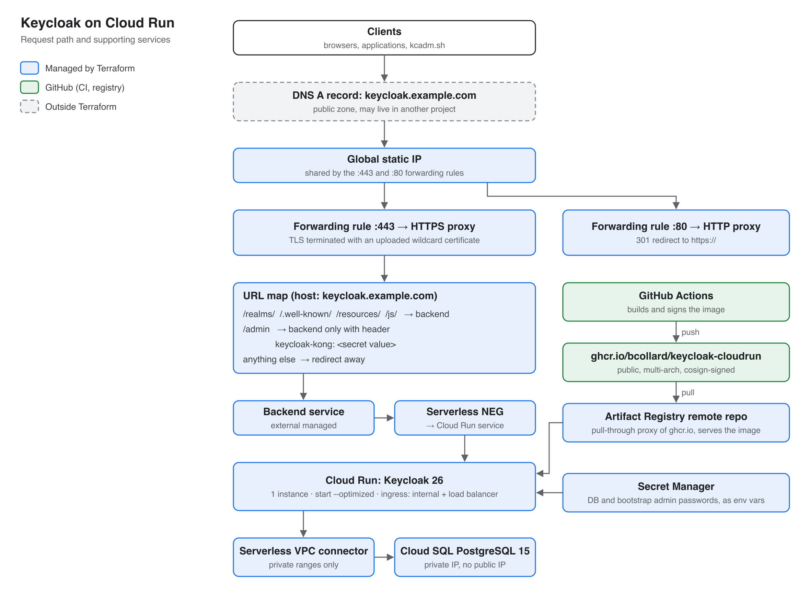
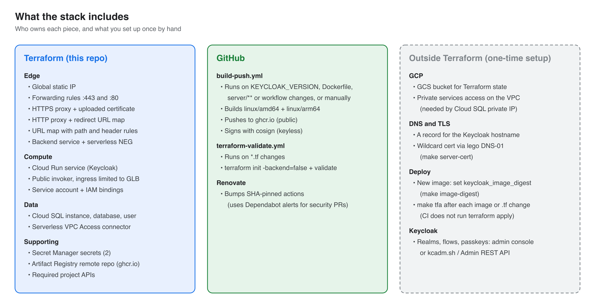
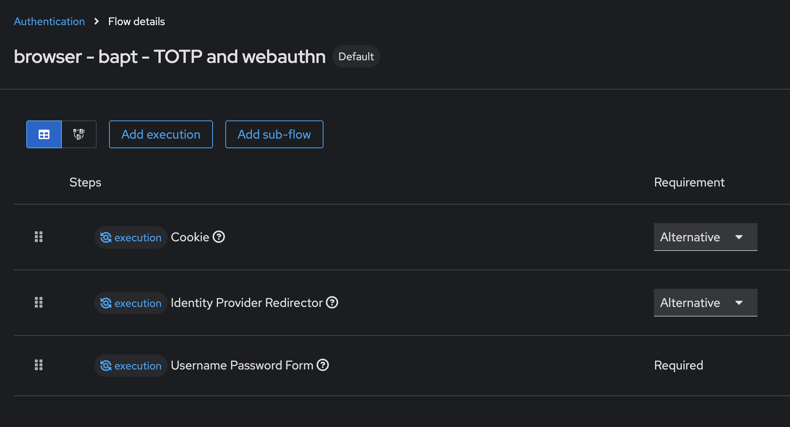
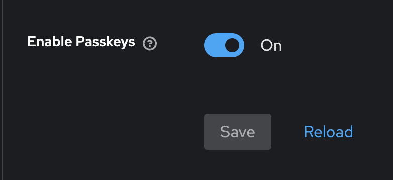
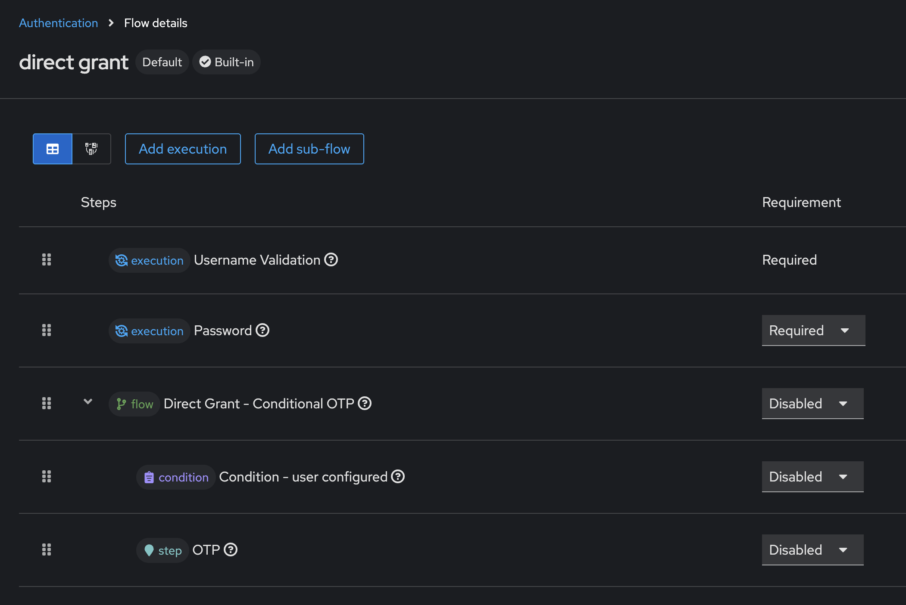

# Keycloak on Google Cloud Run

Terraform and a container build for running Keycloak 26 on Cloud Run, behind a Google Cloud global external Application Load Balancer, with Cloud SQL for PostgreSQL as the database.

- The container image is built by GitHub Actions and published to `ghcr.io/bcollard/keycloak-cloudrun`. It is public and signed with cosign.
- Terraform deploys the rest: Cloud Run, Cloud SQL, secrets, the load balancer and its supporting resources.
- `terraform apply` is run by hand. CI does not deploy.

## Architecture



Request path:

1. DNS resolves the Keycloak hostname to a reserved global static IP.
2. Port 443 terminates TLS with an uploaded certificate. Port 80 only returns a 301 to HTTPS.
3. The URL map sends Keycloak's public paths (`/realms/`, `/.well-known/`, `/resources/`, `/js/`) to the backend.
   - `/admin` is forwarded only when the request carries the header `keycloak-kong: <keycloak_admin_header_value>`.
   - Everything else is redirected away.
4. The backend service reaches Cloud Run through a serverless NEG.
   - Cloud Run ingress is set to `internal-and-cloud-load-balancing`, so the `*.run.app` URL cannot be used to bypass the URL map.
5. Keycloak reaches Cloud SQL over a Serverless VPC Access connector. The database has a private IP only.

## What the stack includes



| Owner | Resources |
|---|---|
| Terraform (`*.tf`) | Global static IP, forwarding rules (:443, :80), HTTPS and HTTP proxies, URL maps, uploaded SSL certificate, backend service, serverless NEG, Cloud Run service and invoker binding, service account and IAM, Cloud SQL instance/database/user, VPC Access connector, Secret Manager secrets, Artifact Registry remote repo (ghcr.io proxy), project APIs |
| GitHub Actions | Multi-arch image build, push to GHCR, cosign signing (`build-push.yml`); `terraform validate` (`terraform-validate.yml`); Renovate for action pins (Dependabot alerts stay on for security PRs) |
| You, once | GCS state bucket, private services access on the VPC, DNS A record, TLS certificate, Keycloak realm configuration |

## Prerequisites

- A GCP project with billing enabled, and `gcloud` authenticated against it.
- Terraform >= 1.10.
- A GCS bucket for Terraform state.
- Private services access on the `default` VPC, so Cloud SQL can get a private IP. See [Configure private services access](https://cloud.google.com/sql/docs/postgres/configure-private-services-access).
- A hostname you control at any DNS provider, and a publicly trusted TLS certificate for it (see [TLS certificate](#tls-certificate)).
- Optional: [gum](https://github.com/charmbracelet/gum) for `make keycloak-build`.

## Setup

### Variables

Configure the state backend and variables:

```bash
cp backend.hcl.example backend.hcl                  # bucket, prefix, optional credentials
cp terraform.tfvars.example values.auto.tfvars      # project, hostname, passwords, LB names
```

Both files are git-ignored.

### TLS certificate

The load balancer uses an uploaded certificate. Terraform reads two PEM files:

| Variable | Content |
|---|---|
| `ssl_certificate_path` | Certificate with its intermediate chain (full chain) |
| `ssl_certificate_key_path` | Private key |

The certificate must cover `keycloak_hostname`, either as a single name or a wildcard. Any CA and any ACME client works. Two examples:

```bash
# lego with your DNS provider (list: https://go-acme.github.io/lego/dns/)
lego run --email me@example.com --dns <provider> -d keycloak.example.com --accept-tos --path ./.lego
# writes .lego/certificates/keycloak.example.com.{crt,key}

# certbot with a manual DNS-01 TXT record
certbot certonly --manual --preferred-challenges dns -d keycloak.example.com
# writes /etc/letsencrypt/live/keycloak.example.com/{fullchain,privkey}.pem
```

If your zone is on Google Cloud DNS, `make server-cert` wraps lego and issues a wildcard certificate:

```bash
export DNS_ZONE_NAME=example.com GCP_PROJECT_DNS=my-dns-project \
       GCP_CREDENTIALS_FILE=/path/to/dns-sa.json ACME_EMAIL=me@example.com
make server-cert   # writes .lego/certificates/_.example.com.{crt,key}
```

### Deploy

```bash
make gcloud-login GCLOUD_CONFIG=my-config   # activates the gcloud config and refreshes ADC
make tfi                                    # terraform init -backend-config=backend.hcl
make tfp                                    # review the plan
make tfa
```

### DNS record

At your DNS provider, create an A record for `keycloak_hostname` pointing at the `forwarding_rule_ip_address` output:

```bash
terraform output -raw forwarding_rule_ip_address
```

## Day-2 operations

| Task | How |
|---|---|
| Upgrade Keycloak | `make keycloak-build` (or edit `KEYCLOAK_VERSION`), commit and push. Wait for the "Build and Push" workflow to finish, then set `keycloak_version` and `keycloak_image_digest` (from `make image-digest`) and run `make tfa`. |
| Rotate the certificate | Renew it (for example `make server-cert`), then `make tfa`. The certificate uses `name_prefix` and `create_before_destroy`, so the proxy switches over without downtime. |
| Change the `/admin` header value | Update `keycloak_admin_header_value`, then `make tfa`. |
| Change the DB password | Update `db_password`, then `make tfa`. This updates both the Cloud SQL user and the secret. Cloud Run reads the secret's `latest` version at startup, so redeploy or restart the revision. |
| Regenerate diagrams | `make diagrams` (requires `rsvg-convert`). |

`terraform plan` reads every `*.tf` file in the working tree. Run `git status` before applying.

## Keycloak configuration

### Build and runtime flags

The image runs `kc.sh build` with health, metrics and the PostgreSQL driver baked in. Cloud Run starts it with `start --optimized`.

`--features=` must be identical in both places, or the optimized start refuses to run:

- `Dockerfile`: `kc.sh build --features=spiffe:v1,cimd:v1,parameterized-scopes:v1,identity-assertion-jwt:v1,client-admin-api:v2`
- `cloudrun.tf`: `args = ["start", "--optimized", "--features=spiffe:v1,cimd:v1,parameterized-scopes:v1,identity-assertion-jwt:v1,client-admin-api:v2"]`

| Flag | Status (26.8) | Purpose |
|---|---|---|
| `spiffe:v1` | preview | SPIFFE trust relationship provider |
| `cimd:v1` | experimental | OAuth Client ID Metadata Document, required by MCP clients since spec 2025-11-25 |
| `parameterized-scopes:v1` | preview | Parameterized OAuth 2.0 client scopes |
| `identity-assertion-jwt:v1` | experimental | Identity Assertion JWT Authorization Grant (ID-JAG), partial |
| `client-admin-api:v2` | preview | [Client Admin API v2](https://www.keycloak.org/admin-api/admin-api-v2) at `/admin/api/{realm}/clients/v2`, alongside the v1 Admin REST API. Behind the same `/admin` header rule on the GLB. |

Since Keycloak 26.6, `token-exchange-standard:v2`, `jwt-authorization-grant:v1` and `kubernetes-service-accounts:v1` are enabled by default. See the [features table](https://www.keycloak.org/server/features).

`server/conf/quarkus.properties` renames the JSON log `level` key to `severity`, so Cloud Logging picks up log levels.

### Admin access

- The bootstrap admin (`keycloak_admin` / `keycloak_admin_password`) is created on the first start against an empty database only. After that, manage admins in Keycloak itself.
- The password is also stored in Secret Manager as `keycloak-kc-admin-pwd`:

  ```bash
  gcloud secrets versions access latest --secret=keycloak-kc-admin-pwd
  ```

- To open the admin console through the load balancer, send the `keycloak-kong` header. For example, use a browser extension that sets request headers, or pass it with `curl -H` / `kcadm.sh`.

### Passkeys (WebAuthn passwordless)

1. Authentication → Flows: duplicate **browser** and set the copy as the default browser flow.
2. Authentication → Required actions: enable **WebAuthn Register** and **WebAuthn Register Passwordless**.
3. Authentication → Policies → Webauthn Passwordless Policy: turn on **Enable Passkeys**.




### Direct grant for kcadm.sh

`kcadm.sh` logs in with the direct grant flow. Disable any OTP step in that flow, or `kcadm.sh` cannot authenticate.



## Files

| File | Purpose |
|---|---|
| `terraform.tf` | Provider versions and the GCS backend (partial config, see `backend.hcl.example`) |
| `provider-google.tf` | Google provider and default labels |
| `variables.tf` | Input variables (see `terraform.tfvars.example`) |
| `apis.tf` | Project APIs the stack needs |
| `cloudrun.tf` | Artifact Registry proxy, VPC connector, Cloud SQL, secrets, IAM, Cloud Run |
| `load-balancer.tf` | Static IP, NEG, backend service, URL maps, proxies, certificate, forwarding rules |
| `Dockerfile` | Optimized Keycloak image |
| `glb-wildcard-cert.sh` | Wildcard certificate via lego on Cloud DNS (`make server-cert`) |
| `scripts/set-keycloak-version.sh` | Interactive `KEYCLOAK_VERSION` bump (`make keycloak-build`) |
| `scripts/diagrams.py` | Source of the diagrams in `docs/img` (`make diagrams`) |

## Troubleshooting

| Symptom | Check |
|---|---|
| 403 on every resource during `plan` | ADC is for the wrong account: `make gcloud-login`. |
| 404 or redirect on `/admin` | The `keycloak-kong` header is missing or wrong. |
| Revision fails to start | `gcloud run services logs read kong-keycloak-on-cloudrun --region=<region> --limit=50`. A `--features` mismatch between `Dockerfile` and `cloudrun.tf` fails the optimized start. |
| Database connection errors | `gcloud sql instances list`, `gcloud compute networks vpc-access connectors list --region=<region>`, and the private services access peering on the VPC. |

## References

- [Keycloak: running in a container](https://www.keycloak.org/server/containers)
- [Keycloak: features](https://www.keycloak.org/server/features)
- [Serverless NEGs for Cloud Run](https://cloud.google.com/load-balancing/docs/negs/serverless-neg-concepts)
- [Cloud Run ingress settings](https://cloud.google.com/run/docs/securing/ingress)
- [Deploying Keycloak on Cloud Run (French)](https://blog.ineat-group.com/2023/09/deployer-keycloak-sous-cloudrun/)

## License

[Apache-2.0](LICENSE)
